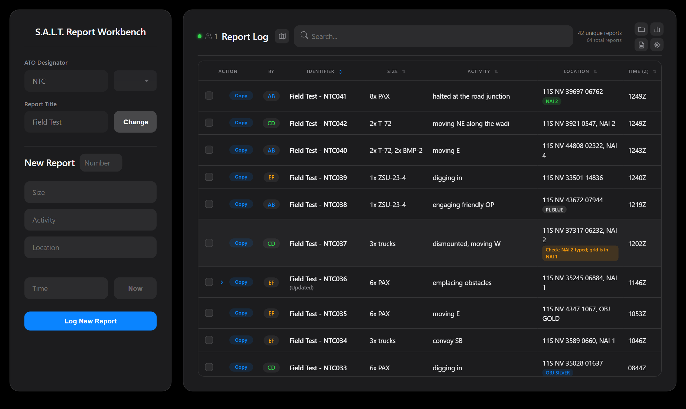
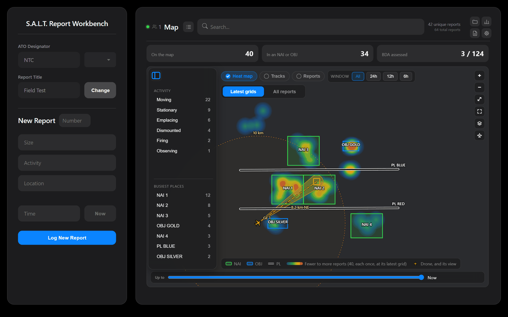
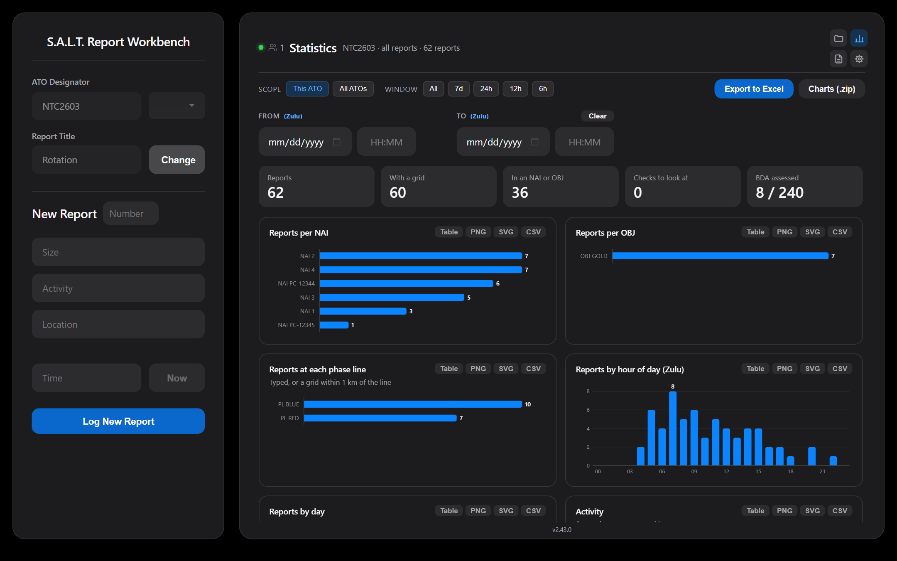
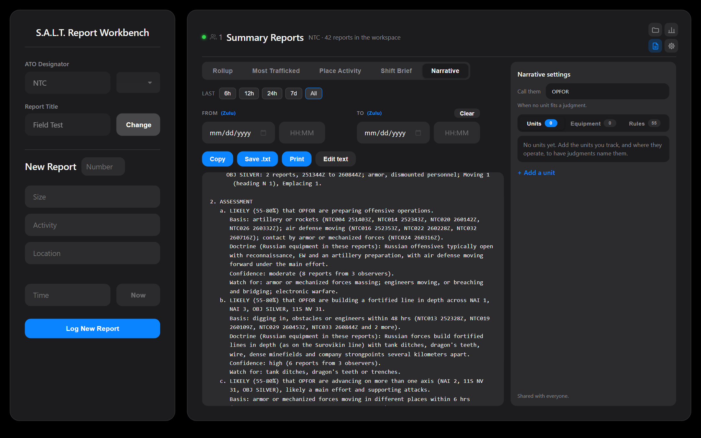
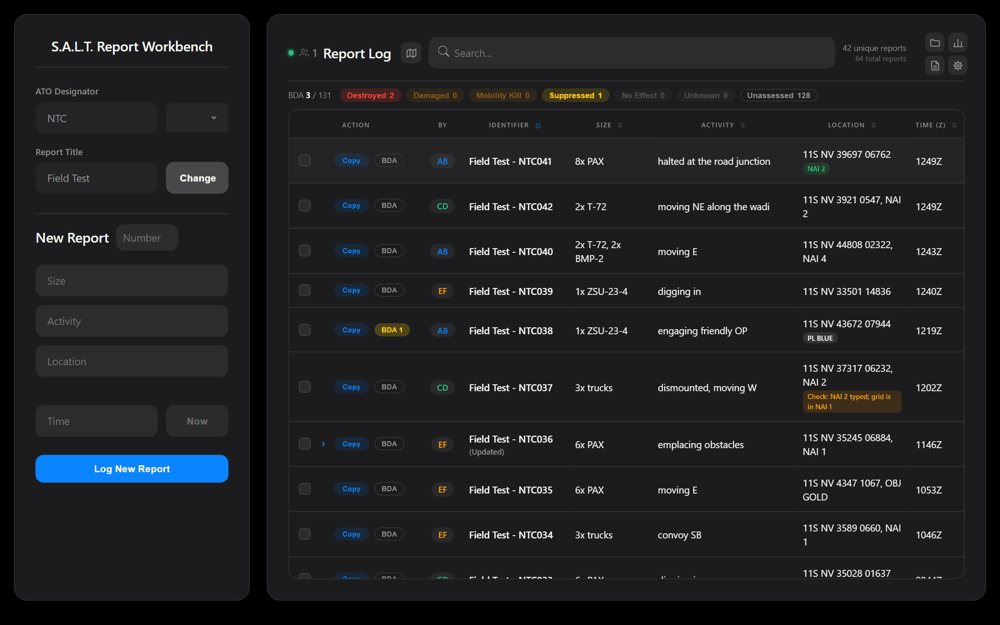

<p align="center">
  <picture>
    <source media="(prefers-color-scheme: dark)" srcset="assets/banner-dark.svg">
    
  </picture>
</p>

<p align="center">
  <strong>Log, share, and assess SALT reports across a local network, with nothing to install but Python.</strong>
</p>

<p align="center">
  
  <a href="https://github.com/MaymiPR/SaltReportWorkbench/actions/workflows/ci.yml"></a>
  
  <a href="LICENSE"></a>
</p>



S.A.L.T. Report Workbench is a reporting tool for reconnaissance operators and the
TOC staff who read their reports. Operators log observations in the **SALT** format
(Size, Activity, Location, Time). Every browser on the network sees each report
within a second, and the server keeps a readable backup of everything.

It is built for networks without internet access, an IT department, or a package
registry:

- **No dependencies.** The server uses only the Python standard library. The page
  is one self-contained HTML file that fetches nothing.
- **Works offline.** Lose the server and changes queue in the browser, then sync
  when it's back. Open the page without a server and it runs on its own.
- **Two ways in.** Editors join with an access code that changes each launch.
  Observers use a separate read-only port that refuses every write.
- **Encrypted.** The server speaks HTTPS with a certificate it makes itself, so
  the code and the reports can't be read off the network.

## How it was made

S.A.L.T. Report Workbench was created entirely with Claude (Anthropic's AI):
every line of code, the brand assets and this documentation. The operators who
use it shaped what it does through field testing, as recorded in
[CHANGELOG.md](CHANGELOG.md).

## Features

### Live reporting

Log a report and every connected browser shows it at once. Locations are checked
against your NAIs, objectives and phase lines, and tagged with the ones they fall
in. *Update* keeps the old version in history; *Edit* corrects in place. Delete and
Restore offer a ten-second Undo.

### Map

The map button beside the Report Log heading opens the map under it. It shows your overlays with the reports as a
heat map, tracks, or dots, over a WMS or tile basemap you add. A sidebar lists
activities and the busiest places, and a slider shows how things stood earlier.
Put a drone (a Gray Eagle, say) on it by its grid, and a cone points from the drone
to the newest report. Shift + click copies the grid of any spot.



### Statistics

Headline numbers and charts for any time window: reports per NAI, objective and
phase line, by hour and day, by activity, heading and equipment type, and BDA.
Export a chart as PNG, SVG or CSV, or everything to one Excel workbook with
editable charts.



### Summary reports

One click writes a Rollup, Most Trafficked, Place Activity, Shift Brief, or
Narrative for any time window. The Narrative lists what was observed, then
assessments from 55 rules based on open-source Russian and Chinese tactics, in
ICD 203 terms, each citing the reports behind it. It recognizes about 790 Russian
and Chinese equipment types and general terms such as vic, tracked, wheeled and
support, and counts a total with its breakdown once. Everything comes from fixed rules and templates, not
AI, so nothing is made up. Reword any report before you copy, save, or print it.



### Battle damage assessment

BDA stays hidden until you turn it on. A checklist pairs each element of a report
with its grid, and a roll-up above the table totals the workspace by outcome.



### View-only port

Observers open the read-only address and watch live, with no access code. Every
write is refused.


### And also

- **Workspaces:** separate ATOs, each with its own reports. Switch, and the team
  switches with you.
- **Report builder:** reorder the lines, switch between SALT and SALT-U, or add
  your own fields such as `W: Weather`.
- **Overlays:** import NAIs, objectives and phase lines from KML, KMZ, GeoJSON or a
  shapefile.
- **Exports:** backups that re-import losslessly, CSV, ArcGIS points and tracks,
  and Excel.
- **Hardened server:** request validation, per-address rate limits, attribution
  clients can't forge, and atomic writes.

## Quick start

You need Python 3.10 or newer and a browser.

**From a release.** Download the zip from the
[Releases page](https://github.com/MaymiPR/SaltReportWorkbench/releases/latest)
and extract it. On Windows, double-click `Start SALT Workbench.bat`. Anywhere else,
run this in that folder:

```bash
python salt_sync_server.py
```

**From source:**

```bash
git clone https://github.com/MaymiPR/SaltReportWorkbench.git
cd SaltReportWorkbench
python scripts/build.py
python dist/salt_sync_server.py
```

The server prints its addresses, an access code and its certificate's
fingerprint, then opens your browser:

```text
 [+] Workbench   : https://10.0.0.12:8080
 [+] Access Code : K7M2X9PQR3
 [+] Read Only   : https://10.0.0.12:8081
 [+] Certificate : B4 BE F7 C2 0A 29 8F 0F 02 64 80 CF 8D 30 03 89
                   08 E7 DC 26 72 0A 90 D5 19 80 BC 79 84 66 3A 60
```

Each browser warns once that the connection isn't private, because the server
made its own certificate. Choose **Advanced**, then **Proceed**. The browser on
the server's own machine fills in the code. Give other editors the **Workbench**
address and the code. Give observers the **Read Only** address.

<p align="center">
  
</p>

For the one-file `.txt` download, checking checksums, upgrading, HTTPS and the
browser warning, the Windows launcher, and where backups live, see
[docs/INSTALL.md](docs/INSTALL.md). What the security model does and doesn't
cover is in [SECURITY.md](SECURITY.md).

## Usage

1. **Pick your initials and workspace** in the first-run dialog, or choose one
   from *Quick Start*.
2. **Log a report.** Fill in Size, Activity, Location and Time, then press
   <kbd>Enter</kbd>. The report is also copied to your clipboard:

   ```text
   Field Test - NTC040
   S: 2x T-72, 2x BMP-2
   A: moving E
   L: 11S NV 44808 02322, NAI 4
   T: 1243Z
   ```

3. **Click a row** to change it. *Update* keeps the old version in history;
   *Edit* overwrites it.
4. **Open the other views** with the icons at the top right: Manage (folder:
   import and export, workspaces, the report format, the map's graphics and
   basemaps), Statistics (chart), Summary Reports (page), and Settings (gear).

The full manual is built into the app: **gear → User Manual**.

| Shortcut | Action |
| --- | --- |
| <kbd>Enter</kbd> | Log or update (in the ATO or Title field: set the workspace) |
| <kbd>Ctrl</kbd>+<kbd>Enter</kbd> | Edit in place, without a history entry |
| <kbd>Esc</kbd> | Cancel the edit, deselect rows, or clear the search |
| <kbd>Ctrl</kbd>+<kbd>S</kbd> | Jump to search |

## Configuration

The server takes command-line flags only. There are no config files or
environment variables.

| Flag | Default | Description |
| --- | --- | --- |
| `--port PORT` | `8080` | Editor port. |
| `--viewer-port PORT` | `8081` | Read-only port. `0` turns it off. |
| `--host HOST` | `0.0.0.0` | Interface to listen on. `127.0.0.1` keeps it to this machine. |
| `--backup-dir DIR` | `Auto Backups/` beside the server | Where backups are written and loaded from. |
| `--access-code CODE` | random each launch | Use a fixed editor code. |
| `--no-access-code` | off | Let anyone on the network edit. **Only on a fully trusted network.** |
| `--cert FILE`, `--key FILE` | the server's own | Use your own TLS certificate and key (PEM), and browsers that trust it don't warn. |
| `--no-https` | off | Plain HTTP. The code and reports cross the network unencrypted. |
| `--no-browser` | off | Don't open a browser on launch. |
| `--no-minimize` | off | Don't minimize the console window (Windows). |

## Development

```bash
python scripts/build.py                  # bundle src/ into dist/
python -m unittest discover -s tests     # server, build and launcher tests
node --test tests/js/core.test.js        # the page's logic
```

Browser tests run when Playwright is installed, and are skipped otherwise. On
macOS and Linux, `make check` runs everything CI runs. See
[CONTRIBUTING.md](CONTRIBUTING.md) for setup and conventions, and
[docs/ARCHITECTURE.md](docs/ARCHITECTURE.md) for the code layout and how sync
works.

## Security

Report vulnerabilities privately; see [SECURITY.md](SECURITY.md).

## License

S.A.L.T. Report Workbench is free software under the
[GNU Affero General Public License v3](LICENSE). It ships no third-party code.
