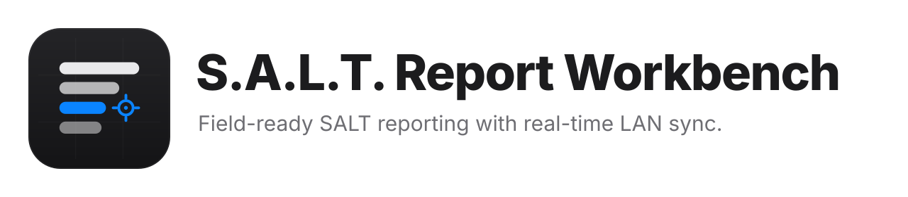
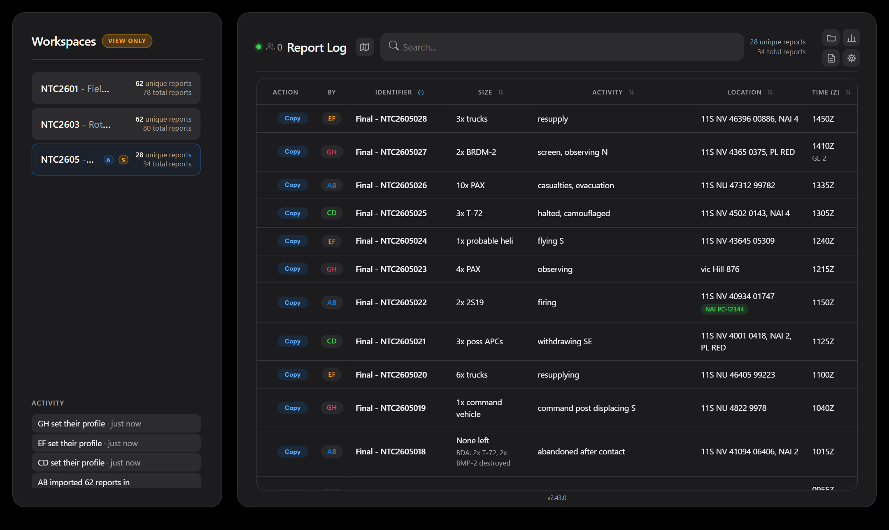
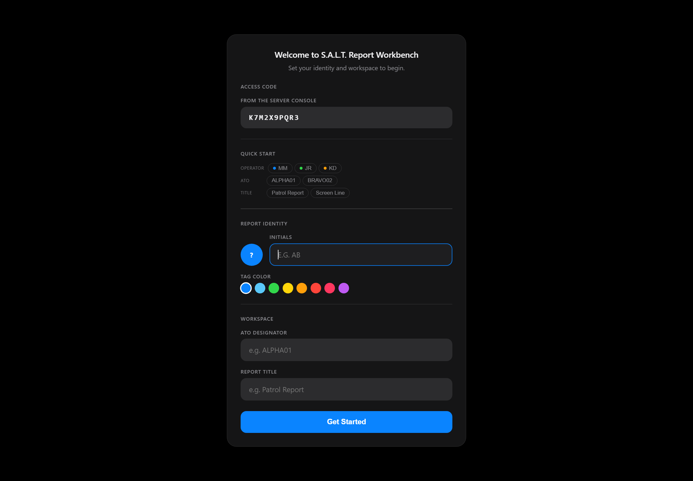

<p align="center">
  <picture>
    <source media="(prefers-color-scheme: dark)" srcset="assets/banner-dark.svg">
    
  </picture>
</p>

<p align="center">
  <strong>Field-ready SALT reporting with real-time LAN sync.</strong><br>
  Log, share, and assess Size · Activity · Location · Time reports across a tactical network,
  with nothing to install but Python.
</p>

<p align="center">
  
  <a href="https://github.com/MaymiPR/SaltReportWorkbench/actions/workflows/ci.yml"></a>
  
  
  <a href="LICENSE"></a>
</p>

---

## Overview

S.A.L.T. Report Workbench is a reporting tool for intelligence and reconnaissance
operators and the TOC staff who consume their reports. Operators log observations
in the doctrinal **SALT** format; every connected browser on the network sees each
report the moment it's logged; and the whole session is continuously backed up to
plain-text files a person can read.

It is built for places where you can't count on the internet, an IT department,
or a package registry:

- **Runs on a stock Python install.** The server uses only the standard library.
  The client is one self-contained HTML file: no CDN, nothing fetched at runtime.
- **Works offline.** Open the HTML file directly and it runs from browser storage.
  Connect to the server and it syncs; lose the server and changes queue locally,
  then replay when it's back.
- **Shares safely.** Editors join with a per-launch access code; observers get a
  separate read-only port that refuses every write.

<p align="center">
  
</p>

## Download

Get the latest release from the [Releases page](https://github.com/MaymiPR/SaltReportWorkbench/releases/latest).
It offers two downloads holding the same five files: the page, the server, the Windows
launcher, the license, and a short `README.txt`.

- **`SaltReportWorkbench-v<version>.zip`**: extract it. On Windows, double-click
  **`Start SALT Workbench.bat`**; anywhere else, run `python salt_sync_server.py` in
  that folder. Python 3.10+ and a browser are all it needs.
- **`SALT-Workbench-v<version>.txt`**: the same files as one plain-text file, for
  transfer systems that refuse zips or scripts. It is about the size of the zip,
  because the files inside are compressed. Run it with Python, and it unpacks into
  a `SALT Report Workbench` folder beside itself, checks every file against the
  checksum written inside, and deletes itself (`--keep` keeps it). It starts
  nothing. It is still a program whatever its extension, and some scanners treat
  a script carrying an encoded block as suspicious. If your network blocks
  scripts on purpose, ask your security office before sending it this way.

  ```bat
  python "SALT-Workbench-v2.11.0.txt"
  ```

**Verify a download.** The release also carries `SHA256SUMS.txt`, one file holding
the checksums of both downloads. Builds are reproducible, so the
checksums are stable. Put it beside what you downloaded, then:

- PowerShell:
  ```powershell
  Get-Content SHA256SUMS.txt | ForEach-Object { $h, $f = -split $_; if (-not (Test-Path $f)) { "--   $f (not here)" } elseif ((Get-FileHash $f).Hash -eq $h) { "OK   $f" } else { "BAD  $f" } }
  ```
- macOS or Linux: `sha256sum -c --ignore-missing SHA256SUMS.txt`

Only the file you downloaded needs to say OK; the other shows as not here.

**Upgrading.** Stop the server and drop the new files over the old ones, or run the
new `.txt` from the folder that holds `SALT Report Workbench`. Keep the `Auto Backups`
folder: reports, overlays, and settings load from it as they are. A `PYTHON_EXE` path
set in the launcher survives an upgrade by `.txt`. If you drop files in by hand,
set it again. See [Windows launcher](#windows-launcher).

> [!IMPORTANT]
> The server speaks plain HTTP. Run it only on a network you trust, or over a VPN.
> See [SECURITY.md](SECURITY.md).

## How it was made

S.A.L.T. Report Workbench was created entirely with Claude (Anthropic's AI):
every line of code, the brand assets and this documentation. The operators who
use it were the reference: their field testing shaped what it does, as recorded
in [CHANGELOG.md](CHANGELOG.md).

## Features

| Feature | What it does |
| --- | --- |
| **Real-time sync** | Server-Sent Events push every change to every browser within a second. Last-modified-wins merging resolves concurrent edits. |
| **Offline-first** | Full functionality from local storage; queued changes replay automatically on reconnect. Each change uploads only the reports it touched, and a report the server refuses stays visible as *Not saved* until it's fixed or discarded. |
| **Report builder** | Reorder lines, switch between SALT and SALT-U, and add custom fields (e.g. `W: Weather`) that get their own form box, table column, and copy-text line. One format for every workspace, synced to the team; it changes only when someone edits it. |
| **Overlays and ArcGIS** | Import NAIs, OBJs, and phase lines once, for every workspace, from KML, KMZ, GeoJSON, or a shapefile; unload or replace them a group at a time. Logging adds the NAI, OBJ, or phase line a grid is in to the Location, and asks you to settle a typed name the grid disagrees with. Export one point per grid, with activity tags and heading, for ArcGIS Pro heat maps (a shapefile to drag in, Esri JSON, GeoJSON, or CSV). |
| **Map** | Its own view: the overlays and the reports as dots, a heat map, or tracks, over your WMS or tile basemaps. Click a report for its card (Edit from there), a row to move the map to it, or an NAI to narrow the table to it; beside it the numbers for what's on the map, under it the table of those reports, and a slider to see how things stood earlier. |
| **Statistics** | Headline numbers and charts for any time window, for one ATO or all of them. Covers reports per ATO, reports per NAI, OBJ and phase line, the hour of day and day, activity and heading, what was reported by type, and BDA. Each chart exports as PNG, SVG, or CSV, or all at once; or everything goes to one Excel workbook, with editable Excel charts and the report table. |
| **Summary reports** | Written reports from one click: Rollup, Most Trafficked, Place Activity, and Shift Brief, over any time window. Copy, save as .txt, or print with charts. They are built from fixed templates, not AI, so nothing is made up. |
| **BDA tracking** | Hidden until you need it. A checklist pre-pairs each element of a report with its grid, so a ten-target assessment is ten clicks, and part of an element can be logged (3 of `40x T-72`) with the rest left to assess. A roll-up above the table totals the workspace by outcome, click-to-filter. Revisable, searchable, exported. |
| **Edit history** | *Update* snapshots the prior version; *Edit* corrects in place. Any prior version can be restored, and Delete and Restore both offer a ten-second Undo. |
| **Workspaces** | Separate ATOs with their own reports. Switch live, and the team switches with you. |
| **View-only port** | Observers watch live on a second port that rejects every write, with no code required. |
| **Map** | The overlays on a map (NAI green, OBJ blue, PL black), over WMS or tile basemaps you switch between (a WMS's layers looked up from its link), fetched only for that area, with a heat map (each report once) or a track map (each report's path, first to latest, with its direction). Full screen; viewers get it as a Map tab. |
| **Exports** | Human-readable backups that re-import losslessly, CSV (including history and BDA rows, or the latest version only), ArcGIS points and tracks, and MTI tracked/wheeled splits. |
| **Hardened server** | Per-endpoint schema validation, per-IP rate limiting, server-stamped attribution that clients can't forge, atomic writes, and a 16 MB body cap. |

## Quick start

**Prerequisites:** Python 3.10 or newer and any modern browser. That's all.

```bash
git clone https://github.com/MaymiPR/SaltReportWorkbench.git
cd SaltReportWorkbench
python scripts/build.py
python dist/salt_sync_server.py
```

On Windows you can instead double-click **`dist/Start SALT Workbench.bat`**. See
[Windows launcher](#windows-launcher) below.

The server prints its addresses and an access code, then opens your browser:

```text
 [+] Workbench   : http://10.0.0.12:8080
 [+] Access Code : K7M2X9PQR3
 [+] Read Only   : http://10.0.0.12:8081
```

Your own browser fills in the code automatically. Share the **Workbench** URL and
the code with other editors, and the **Read Only** URL with anyone who only needs
to watch.

<p align="center">
  
</p>

### Distributing to a team

`python scripts/build.py` produces a `dist/` folder containing three files:
`index.html`, `salt_sync_server.py`, and `Start SALT Workbench.bat`. Copy that folder
to any machine with Python and run the server; nothing else is needed. Every CI run
also publishes `dist/` as a downloadable artifact.

### One file, for strict transfer systems

Each release also carries the one-file `SALT-Workbench-v<version>.txt` (see
[Download](#download) for using it). The unpacker at the top and each file's
SHA-256 can be read in Notepad. The files follow, compressed with LZMA and written
as Base85 text in short lines, about a quarter of the size of storing them as
text. `scripts/pack.py --plain` writes the larger form, where every line of every
file can be read. `python scripts/release.py <version>` builds both downloads and their
checksum file into `release/` in one go; `scripts/pack.py` packs an existing zip on
its own.

### Windows launcher

`Start SALT Workbench.bat` starts the server with a double-click. It needs no
install and no admin rights, and works from a network share. It uses the first
Python 3.10+ it finds, in this order:

1. The path on the `set "PYTHON_EXE="` line near the top of the file. If your
   machine needs a specific `python.exe`, open the launcher in Notepad and put the
   full path between the quotes:
   ```bat
   set "PYTHON_EXE=C:\Tools\Python312\python.exe"
   ```
2. The `SALT_PYTHON` environment variable, which you can set once per user
   without editing the file and without admin rights:
   ```bat
   setx SALT_PYTHON "C:\Tools\Python312\python.exe"
   ```
3. A portable Python in a `python\` folder beside the launcher (for example the
   embeddable package from python.org, unzipped as `python\`).
4. The `py` launcher, then `python` on `PATH`.
5. Standard install folders that were never added to `PATH`.

If you set a path in step 1 or 2 and it doesn't work, the launcher says so and
stops instead of quietly using some other Python. Anything you type after the
launcher's name goes to the server, for example
`"Start SALT Workbench.bat" --port 9090`.

### Without a server

Open `dist/index.html` directly in a browser. It runs in **local mode**: reports
live in that browser's storage, there's no access code, and exports work as usual.

## Usage

The full user manual is built into the app (**gear → User Manual**). The essentials:

1. **Set your identity and workspace** in the startup dialog, or pick existing
   ones from *Quick Start*.
2. **Log a report** with Size, Activity, Location, and Time. <kbd>Enter</kbd>
   submits, and the report is copied to your clipboard in SALT format. Several MGRS
   grids typed without commas are separated for you; with **gear → MGRS Lock**
   you set the grid zone and square once and type only the digits.
3. **Click a row** to edit it. *Update* keeps the old version in history; *Edit*
   overwrites it.
4. **Track BDA** with **gear → Show BDA**, then the *BDA* pill on any report.
5. **Shape the report** in **folder → Builder**.

| Shortcut | Action |
| --- | --- |
| <kbd>Enter</kbd> | Log or update (in the ATO/Title fields: set the workspace) |
| <kbd>Ctrl</kbd>+<kbd>Enter</kbd> | Edit in place, without a history entry |
| <kbd>Esc</kbd> | Cancel the edit, deselect rows, or clear the search |
| <kbd>Ctrl</kbd>+<kbd>S</kbd> | Jump to search |

## Configuration

All configuration is command-line flags. There are no environment variables or
config files, so there is no `.env` to manage.

| Flag | Default | Description |
| --- | --- | --- |
| `--port PORT` | `8080` | Editor port. |
| `--viewer-port PORT` | `8081` | Read-only port. `0` disables it. |
| `--host HOST` | `0.0.0.0` | Interface to bind. `127.0.0.1` restricts to this machine. |
| `--backup-dir DIR` | `Auto Backups/` beside the server | Where backups are written and loaded from. |
| `--access-code CODE` | random per launch | Use a fixed editor code. |
| `--no-access-code` | off | Disable the editor gate. **Only on a fully trusted network.** |
| `--no-browser` | off | Don't open a browser on launch. |
| `--no-minimize` | off | Don't minimize the console window (Windows). |

### Data and backups

Every change is written, debounced, to the changed workspace's own file,
`{ATO}_{Title}.txt`, in the backup folder: a readable summary of each report
on top, and a machine-readable JSON block below that the server reloads on the
next start. Writes are atomic, so a crash never leaves a half-written file.
Unloading a workspace leaves its file in place, so a restart brings it back.
(Before 2.4 one file held every loaded workspace; such files still load, and
the first save after upgrading gives each workspace its own file.)

Because that file is replaced within half a second of every change, the server
also keeps dated copies in `Auto Backups/snapshots/`: one on every start and
then at most one an hour, the newest 48 kept. To go back to an earlier state,
stop the server, copy the snapshot you want over the live file, and start it
again. The snapshots folder itself is never loaded.

`Auto Backups/audit.log` records every accepted write as one line: when, who
(the operator's initials and address), and what, such as
`save_reports ALPHA: 1 report(s)` or `delete_history ALPHA: 2 entries`, plus
server starts and stops. It answers "who changed this, and when" after the
fact; nothing reads it.

> [!IMPORTANT]
> Backups contain your actual reports. `Auto Backups/` is git-ignored; keep it
> that way, and handle the folder according to your unit's data-handling rules.

## Project structure

```text
.
├── src/                      Frontend sources (edited by hand)
│   ├── index.html            Markup and the built-in user manual
│   ├── styles.css
│   ├── core.js               Pure logic (formatting, parsing, exports); unit-tested
│   └── app/                  DOM, state, and sync: ordered scripts sharing one scope
│       ├── 10-state.js       Elements, state, helpers, toasts
│       ├── 20-render.js      The report table, BDA panel and roll-up
│       ├── 30-form.js        Entry, editing, restore, undo
│       ├── 40-io.js          Workspaces panel, builder, export, import
│       ├── 45-overlays.js    Overlay import (KML, KMZ, GeoJSON, SHP), Overlays tab, ArcGIS export
│       ├── 46-map.js         The map: basemap, report dots, heat map, tracks
│       ├── 47-stats.js       Statistics panel: charts, hover, tables, PNG / SVG / Excel export
│       ├── 48-summary.js     Summary Reports panel: written reports, copy, .txt, print
│       ├── 49-mapview.js     Map view: the map, what's on it, its table, the report card
│       ├── 50-sync.js        Push, pull, SSE, offline queue
│       ├── 60-handlers.js    Event wiring
│       └── 70-startup.js     Restore saved state, then connect
├── server/
│   ├── salt_sync_server.py   Standard-library HTTP + SSE sync server
│   └── Start SALT Workbench.bat  Windows double-click launcher
├── scripts/
│   ├── build.py              Bundles src/ into dist/index.html, copies the server and launcher
│   ├── pack.py               Packs a release zip into one self-unpacking text file
│   └── release.py            Builds a release: the zip, the one-file .txt, and SHA256SUMS.txt
├── tests/                    Python tests (server, HTTP API, build, pack, release, launcher); js/ for core.js
├── assets/                   Logo, icon, banners, social preview (see BRAND.md)
├── docs/                     Architecture notes and screenshots
└── dist/                     Build output (git-ignored)
```

See [`docs/ARCHITECTURE.md`](docs/ARCHITECTURE.md) for how sync, merging,
persistence, and access control fit together.

## Development

The app has no dependencies, and the dev tools are optional.

```bash
python scripts/build.py                  # bundle src/ into dist/
python server/salt_sync_server.py        # run against the dev build
python -m unittest discover -s tests     # server, build, launcher: standard library only
node --test tests/js/core.test.js        # the page's logic: Node's built-in runner

pip install ruff==0.17.2 pre-commit      # optional tooling
ruff check . && ruff format --check .
pre-commit install                       # lint on every commit

pip install playwright && playwright install chromium   # optional: browser tests
python -m unittest tests.test_browser    # drives the built page in Chromium
```

The browser tests are skipped when Playwright isn't installed, so the plain
test command works anywhere Python does.

On macOS and Linux, `make help` lists shortcuts for the same commands, and
`make check` runs everything CI runs.

CI runs lint, the test suite on Python 3.10–3.15 (Ubuntu) and 3.13 and 3.15 (Windows),
the browser tests in Chromium, and a build that starts the bundled server and
checks the editor page, the viewer port, and that writes to the viewer are
refused.

See [CONTRIBUTING.md](CONTRIBUTING.md) for the workflow and conventions.

## Security

Please report vulnerabilities privately; see [SECURITY.md](SECURITY.md).

## License

S.A.L.T. Report Workbench is free software under the
[GNU Affero General Public License v3](LICENSE). It is built with nothing but
the Python standard library and a single self-contained HTML page, so it has no
third-party code or licenses to ship with a download.

Python is a trademark of the Python Software Foundation and Windows is a
trademark of Microsoft; other names are trademarks of their owners and are used
only to describe compatibility.
