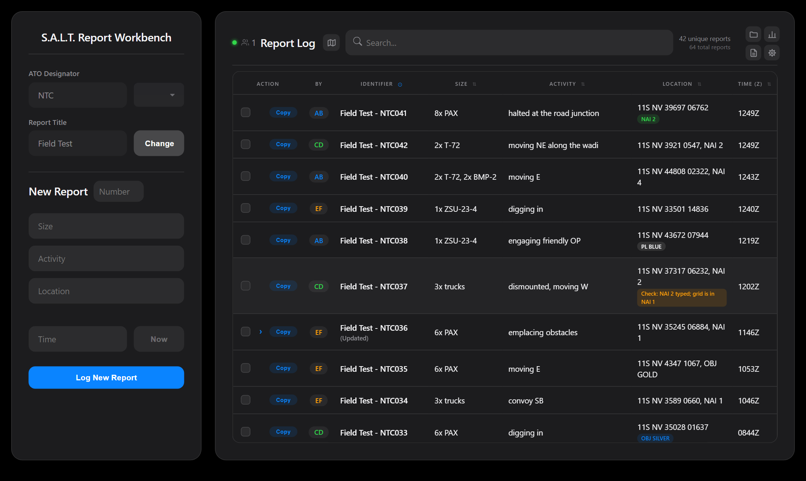
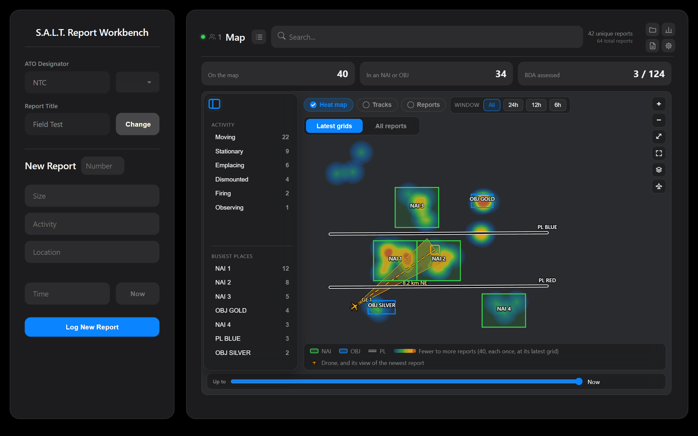
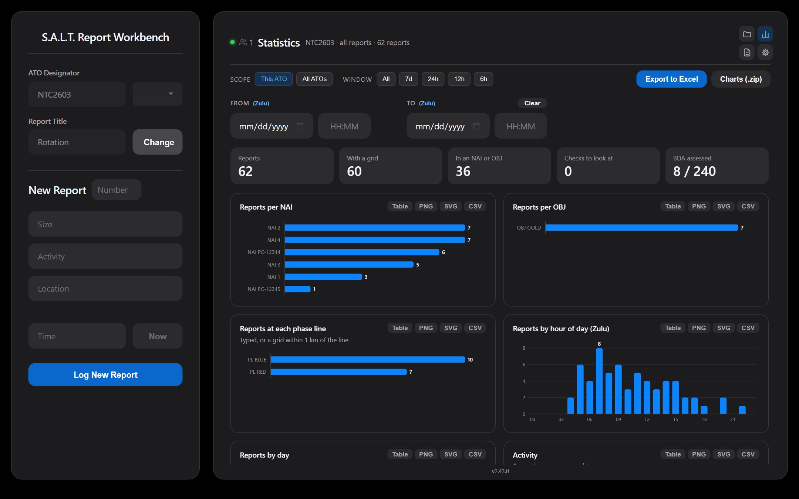
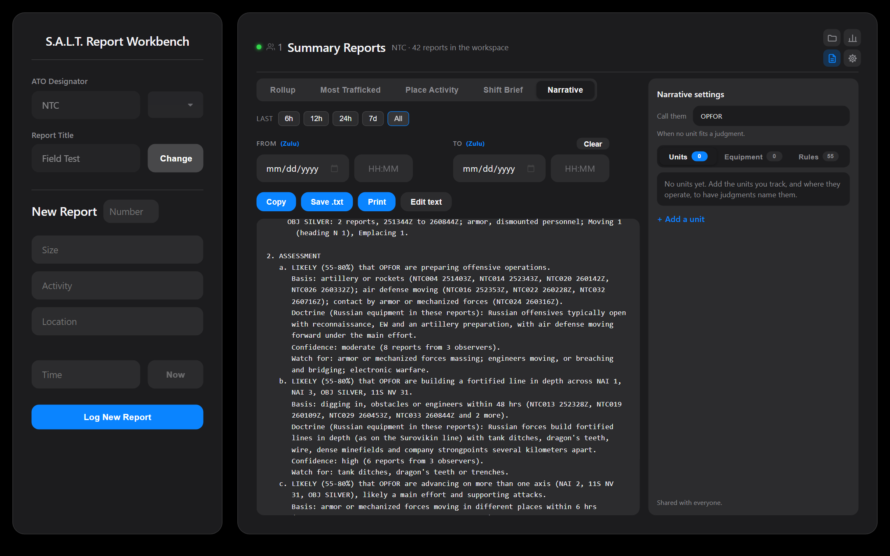
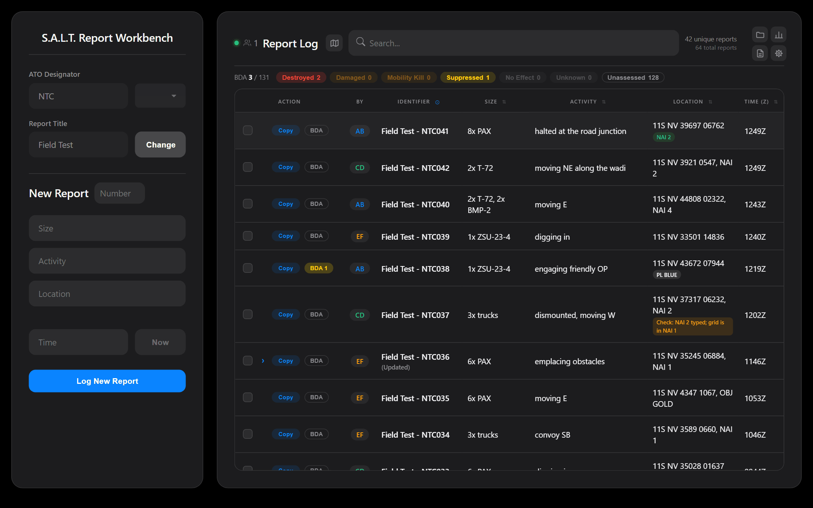
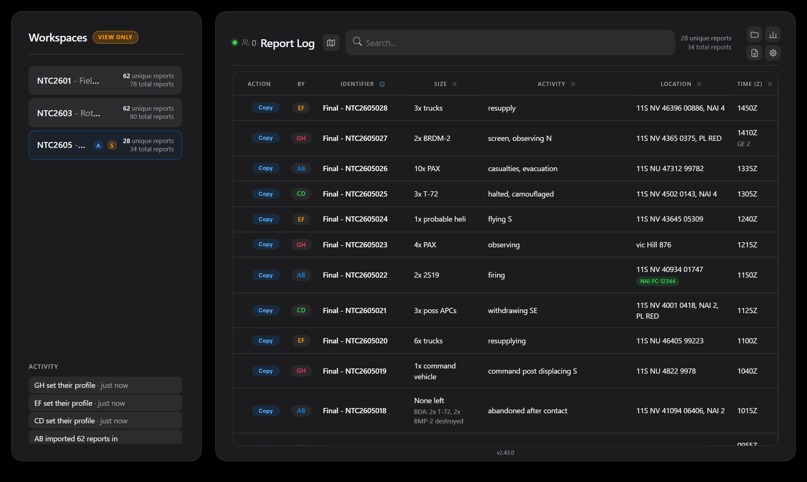
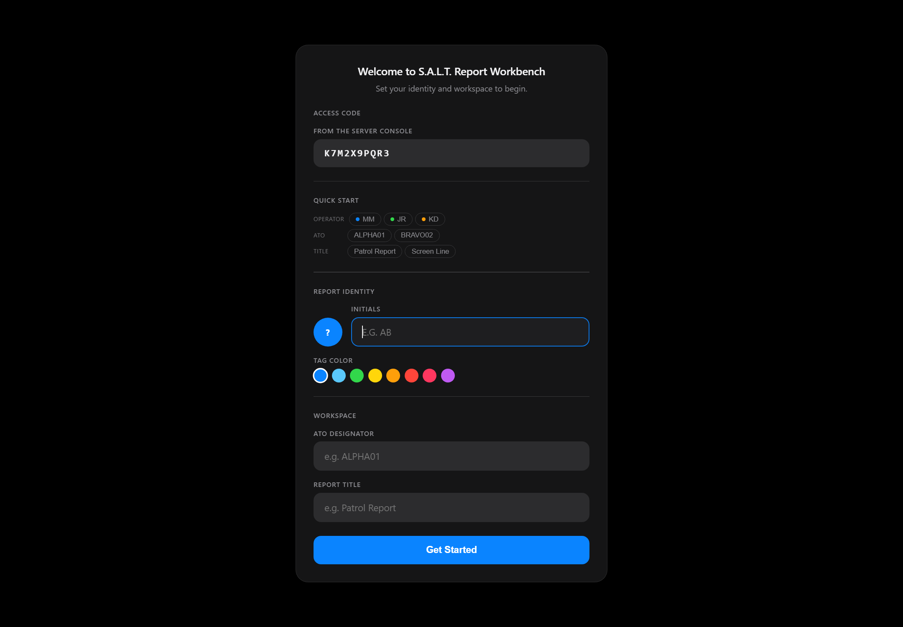

<p align="center">
  <picture>
    <source media="(prefers-color-scheme: dark)" srcset="assets/banner-dark.svg">
    
  </picture>
</p>

<p align="center">
  <strong>Log, share, and assess SALT reports across a local network, with nothing to install but Python.</strong>
</p>

<p align="center">
  
  <a href="https://github.com/MaymiPR/Salt-Report-Workbench/actions/workflows/ci.yml"></a>
  
  <a href="LICENSE"></a>
</p>



S.A.L.T. Report Workbench is a reporting tool for reconnaissance operators and the
TOC staff who read their reports. Operators log observations in the **SALT** format
(Size, Activity, Location, Time). Every browser on the network sees each report
within a second, and the server keeps a readable backup of everything.

It is built for networks without internet access, an IT department, or a package
registry:

- **No dependencies.** The server uses only the Python standard library. The page
  is one self-contained HTML file that fetches nothing.
- **Works offline.** Lose the server and changes queue in the browser, then go
  on their own as soon as it's back. Open the page without a server and it runs
  on its own.
- **Two ways in.** Editors join with an access code that changes each launch.
  Observers use a separate read-only port that refuses every write.
- **Encrypted.** The server speaks HTTPS with a certificate it makes itself, so
  the code and the reports can't be read off the network.
- **Made to last an operation.** Weeks of reports, 2,000 map graphics, a dropped
  network or a pulled USB stick: saves never fail silently, and the server keeps
  hourly snapshots and a log of what went wrong.

## How it was made

S.A.L.T. Report Workbench was created entirely with Claude (Anthropic's AI):
every line of code, the brand assets and this documentation. The operators who
use it shaped what it does through field testing, as recorded in
[CHANGELOG.md](CHANGELOG.md).

## Features

### Live reporting

Log a report and every connected browser shows it at once. It is copied to your
clipboard as you log it. Locations are checked against your NAIs, objectives and
phase lines, and tagged with the ones they fall in. **MGRS Lock** checks a grid
as you type it, and two reports logged with one number are flagged. *Update*
keeps the old version in history; *Edit* corrects in place, stamped with who made
it. Delete and Restore offer a ten-second Undo, and an Activity list shows who
changed what, lately.

### Map

The map button beside the Report Log heading opens the map under it, for viewers
too:

- **Your graphics:** NAIs, objectives, phase lines, axes of advance and your own
  tags, up to 2,000 graphics, imported from KML, KMZ, GeoJSON or a shapefile.
  Each tag in the key switches on and off.
- **The reports** as a heat map, tracks or dots, over a WMS or tile basemap you
  add. A sidebar lists activities and the busiest places, and a time slider with
  **Play** shows how things stood earlier.
- **A report's card:** what it says, its updates, its rate of march, and, with an
  elevation source, what it can see and how far its weapons reach, drawn on the
  map.
- **Drones,** in FMV mode: put a drone (a Gray Eagle, say) on the map by its
  grid, with its range ring and a cone to the newest report it observed, and
  name on each report the drone it was seen from.
- **Measure tools:** distance, range rings, time-distance, line of sight
  between any two points up to 20 km, and drawing an axis of advance.
- **Go to a grid**, and Shift + click to copy the grid of any spot.
- **Save as PNG or print** the view for a brief, with its key and scale bar.



### Statistics

Headline numbers and charts for any time window: reports per NAI, objective and
phase line, by hour and day, by activity, heading and equipment type, and BDA.
Export a chart as PNG, SVG or CSV, or everything to one Excel workbook with
editable charts.



### Summary reports

One click writes a Rollup, Most Trafficked, Place Activity, Shift Brief, or
Narrative for any time window, and keeps it up to date as reports come in.

The **Narrative** opens with a bottom line up front: the strongest judgments,
the force's size, how it moves, the objective it is closest to, the places most
under its weapons, the ground, the activity, the latest report, what to watch
for and the first gap. Then come the situation, the enemy forces, one line per
judgment from 58 rules based on open-source Russian and Chinese tactics in ICD 203
terms, what to watch for, and the collection the gaps call for. Each judgment's
basis and reports open under it.

- **It knows the equipment:** about 800 Russian and Chinese types, how each moves
  (tracked, wheeled, towed, on foot, in the air), how far 117 of them reach with
  their main weapons, and general terms such as vic, tracked, wheeled and
  support. "2x possible tanks" is read as such, and a total with its breakdown is
  counted once.
- **It reads movement:** headings, the enemy's way of march, columns and their
  rate of march, phase lines crossed, and whether a report is closing on an
  objective.
- **It reads the ground,** with an elevation source your GIS team serves (a WMS
  or a tile service): high ground held, slopes too steep for a column, artillery
  behind a crest, and which NAIs and objectives each observer can see.

Everything comes from fixed rules and templates, not AI, so nothing is made up.
Reword any report before you copy, save, or print it.



### Battle damage assessment

BDA stays hidden until you turn it on. A checklist pairs each element of a report
with its grid, and a roll-up above the table totals the workspace by outcome. A
report's destroyed elements come off its Size.



### Missions

**Done with Mission** (Manage > Workspaces) ends a mission and starts the next
from nothing: your browser downloads a backup of every workspace, and the server
moves the reports, the audit log and the snapshots into a folder of its own
under `Mission Archives`. **Previous Missions** lists the finished ones: recall
the settings you tick (overlays, tags, drones, the report format, the narrative
settings) or load their workspaces back. **Refresh** has the server read its
backup folder again, without a restart.

### View-only port

Observers open the read-only address and watch live, with no access code. Every
write is refused.



### Made to last an operation

- **Nothing is lost to a bad connection.** Changes made while the server can't be
  reached stay in the browser, are sent again every few seconds, and go as soon
  as it's back. A red **Not saving** bar says when they are waiting. A request
  the server never answers gives up instead of hanging.
- **Saves never fail silently.** If the backup folder can't be written (a full
  disk, a pulled USB stick), the console says `Error saving`, `/api/health`
  reports it, and the save is retried until it works. Stopping says plainly
  `Changes NOT saved` when they weren't. Closing the console window saves first,
  as Ctrl+C does.
- **A way back.** Hourly snapshots (the newest 48 kept), and `--restore` to put
  one back. Every change is in `audit.log` with who made it.
- **A record when something goes wrong.** The server keeps its messages, with
  times and full error details, in `Server Logs/server.log`.
  [OPERATIONS.md](docs/OPERATIONS.md) says what to send back.
- **Fast with a lot on it.** With 2,000 reports and 2,000 graphics, the Narrative
  is written in well under a second, the map zooms smoothly, and the browser
  keeps one connection to the server instead of one per map tile.

### And also

- **Workspaces:** separate ATOs, each with its own reports. Each editor works in
  their own, and the Workspaces list shows who is where.
- **Report builder:** reorder the lines, switch between SALT and SALT-U, or add
  your own fields such as `W: Weather`.
- **Exports:** backups that re-import losslessly, CSV (with an MTI split into
  tracked and wheeled), ArcGIS points and tracks, and Excel. Spreadsheet cells
  can't run as formulas.
- **Settings:** metric or imperial units, Add Nearby Places, and FMV mode for
  the team.
- **Accessible:** the page works from the keyboard and names its controls for
  screen readers, text reaches WCAG 4.5:1 contrast, and reduced motion is
  honored.
- **Hardened server:** request validation, per-address rate limits, refusal of
  cross-site writes, an audit log with each writer's address, and atomic,
  retried writes.

## Quick start

You need Python 3.11.8 or newer and a browser.

**From a release.** Download the zip from the
[Releases page](https://github.com/MaymiPR/Salt-Report-Workbench/releases/latest)
and extract it. On Windows, double-click `Start SALT Workbench.bat`. Anywhere else,
run this in that folder:

```bash
python salt_sync_server.py
```

**Upgrading?** Each zip extracts to a new folder named for its version, and
that new folder starts with an empty `Auto Backups`. **Copy the `Auto Backups`
and `Mission Archives` folders from your old folder into the new one before
starting** (or extract the new files over the old ones). Your reports are in
`Auto Backups`; so is the server's certificate (`Auto Backups/tls`), so copying
it keeps the same certificate and browsers don't warn again. `Mission Archives`
holds the finished missions. `Server Logs` can come too, but isn't needed.

**From source:**

```bash
git clone https://github.com/MaymiPR/Salt-Report-Workbench.git
cd Salt-Report-Workbench
python scripts/build.py
python dist/salt_sync_server.py --backup-dir .dev-data
```

`--backup-dir .dev-data` (git-ignored) keeps your reports, snapshots and the
TLS key out of `dist/`, the build output, as `make run` does.

The server prints its addresses, an access code and its certificate's
fingerprint, then opens your browser:

```text
[+] Workbench   : https://10.0.0.12:8080
[+] Access Code : K7M2X9PQR3
[+] Read Only   : https://10.0.0.12:8081
[+] Certificate : B4 BE F7 C2 0A 29 8F 0F 02 64 80 CF 8D 30 03 89
                  08 E7 DC 26 72 0A 90 D5 19 80 BC 79 84 66 3A 60
```

Each browser warns once that the connection isn't private, because the server
made its own certificate. Choose **Advanced**, then **Proceed**. The browser on
the server's own machine fills in the code. Give other editors the **Workbench**
address and the code. Give observers the **Read Only** address.

<p align="center">
  
</p>

For the one-file `.txt` download, checking checksums, upgrading, HTTPS and the
browser warning, the Windows launcher, where backups live, and troubleshooting
(the firewall prompt, a port in use, missing reports), see
[docs/INSTALL.md](docs/INSTALL.md). What the security model does and doesn't
cover is in [SECURITY.md](SECURITY.md).

### Where things are kept

Beside the server (or under `--backup-dir`'s parent):

| Folder | What's in it |
| --- | --- |
| `Auto Backups/` | One readable backup per workspace, the shared settings, `audit.log`, hourly `snapshots/`, and the certificate in `tls/` |
| `Mission Archives/` | Each finished mission in a folder of its own |
| `Server Logs/` | `server.log`, the server's messages and errors, 1 MB × 3 kept |

At the end of an operation, copy `Auto Backups` and `Mission Archives` to where
your unit keeps records.

## Usage

1. **Pick your initials and workspace** in the first-run dialog, or choose one
   from *Quick Start*.
2. **Log a report.** Fill in Size, Activity, Location and Time, then press
   <kbd>Enter</kbd>. The report is also copied to your clipboard:

   ```text
   Field Test - NTC040
   S: 2x T-72, 2x BMP-2
   A: moving E
   L: 11S NV 44808 02322, NAI 4
   T: 1243Z
   ```

3. **Click a row** to change it. *Update* keeps the old version in history;
   *Edit* overwrites it.
4. **Open the other views** with the icons at the top right: Manage (folder:
   import and export, workspaces and missions, the report format, the map's
   graphics and basemaps, your identity), Statistics (chart), Summary Reports
   (page), and Settings (gear). The map button sits beside the Report Log
   heading.

The full manual is built into the app: **gear → User Manual**.

| Shortcut | Action |
| --- | --- |
| <kbd>Enter</kbd> | Log or update (in the ATO or Title field: set the workspace) |
| <kbd>Ctrl</kbd>+<kbd>Enter</kbd> | Edit in place, without a history entry |
| <kbd>Esc</kbd> | Close what's open, cancel the edit, deselect rows, or clear the search |
| <kbd>Ctrl</kbd>+<kbd>S</kbd> | Jump to search |
| <kbd>Shift</kbd> + click on the map | Copy the grid under the pointer |
| <kbd>Ctrl</kbd> + scroll on the map | Zoom (a plain scroll in full screen) |

## Configuration

The server takes command-line flags only. There are no config files or
environment variables.

| Flag | Default | Description |
| --- | --- | --- |
| `--port PORT` | `8080` | Editor port. |
| `--viewer-port PORT` | `8081` | Read-only port. `0` turns it off. |
| `--host HOST` | `0.0.0.0` | Interface to listen on (IPv4). `127.0.0.1` keeps it to this machine. |
| `--backup-dir DIR` | `Auto Backups/` beside the server | Where backups are written and loaded from. |
| `--access-code CODE` | random each launch | Use a fixed editor code: 6 to 64 letters, digits, `-` or `_`. |
| `--no-access-code` | off | Let anyone on the network edit. **Only on a fully trusted network.** |
| `--cert FILE`, `--key FILE` | the server's own | Use your own TLS certificate and key (PEM), and browsers that trust it don't warn. |
| `--no-https` | off | Plain HTTP. The code and reports cross the network unencrypted. |
| `--no-browser` | off | Don't open a browser on launch. |
| `--no-minimize` | off | Don't minimize the console window (Windows). |
| `--restore SNAPSHOT` | | Put a snapshot round back in place of the backups and exit (`list` shows them, `latest` takes the newest). Run it with the server stopped. |

[docs/OPERATIONS.md](docs/OPERATIONS.md) is the guide for whoever runs the
server: the console's list of who is connected, `/api/health`, what the
warnings mean, backups and restoring, the end of an operation, and sending a
problem report.

## Development

```bash
python scripts/build.py                  # bundle src/ into dist/
python -m unittest discover -s tests     # server, build, bump, pack, release, launcher, docs, styles, browser
node --test tests/js/core.test.js        # the page's logic
```

Browser tests run when Playwright is installed, and are skipped otherwise. CI
runs everything on Linux and Windows from Python 3.11.8 to the newest, the
browser tests on 3.11.8 and 3.15, and builds, unpacks and starts the release on
Windows with 3.11.8, as operators run it. On macOS and Linux, `make check` runs
most of what CI runs (not the smoke tests of the built server and of the
release). See [CONTRIBUTING.md](CONTRIBUTING.md) for setup and conventions, and
[docs/ARCHITECTURE.md](docs/ARCHITECTURE.md) for the code layout and how sync
works.

## Security

Report vulnerabilities privately; see [SECURITY.md](SECURITY.md).

## License

S.A.L.T. Report Workbench is free software under the
[GNU Affero General Public License v3](LICENSE). It ships no third-party code.
